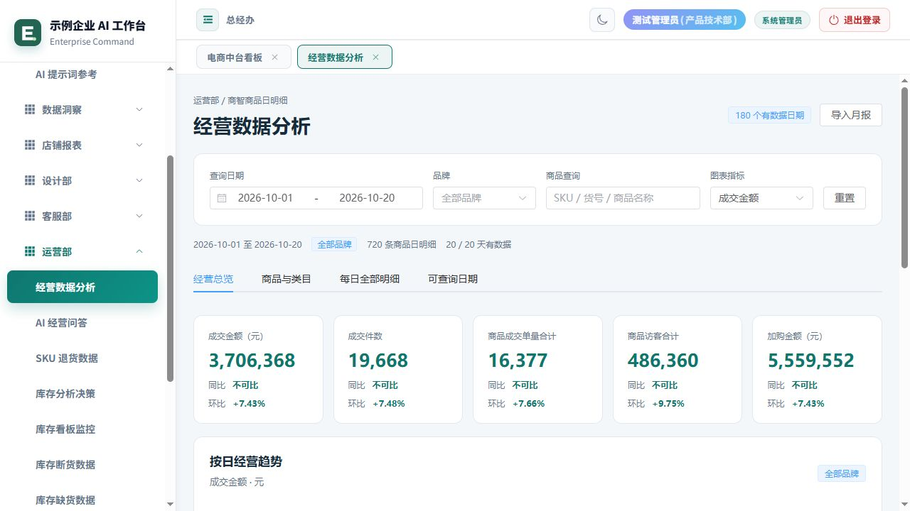

# Enterprise Agent · 企业 AI 工作台

面向面试展示的完整企业 AI 应用。公开版本直接运行原项目的 **Vue 3 + TypeScript + Element Plus + ECharts 界面、FastAPI 接口和 MySQL 业务服务**，保留原导航、表格、图表、导入导出、权限及交互流程。企业名称、人员、商品、报表、图片和附件均替换为虚构测试资料。



## 克隆并启动完整应用

安装 Docker Desktop（含 Docker Compose 2.24+），启动 Docker 后执行：

```bash
git clone https://github.com/yangXYH/enterprise-agent-demo.git
cd enterprise-agent-demo
docker compose up --build
```

首次启动会安装依赖、编译原 Vue 项目、创建独立 MySQL 演示库并生成测试资料。看到后端启动完成后，打开 <http://127.0.0.1:4173>。

默认账号：**`demo_admin` / `Demo@2026`**。还可使用 `demo_boss`、`demo_hr`、`demo_operator`、`demo_designer`、`demo_supply`，密码相同，用于演示原角色权限和字段脱敏。演示账户仅供本机测试。

数据库、上传资料和生成附件保存在 Docker 命名卷中，重启保留修改。停止服务使用 `docker compose down`。启动程序只允许专用的 `enterprise_agent_demo` 或其测试后缀数据库，遇到没有演示归属标记的已有业务库会拒绝初始化。

Windows 可以双击 `start-demo.cmd`：已有 Python 虚拟环境时启动本机完整应用，否则优先使用 Docker；没有 Docker 时需自行准备 Python 3.12+ 和 MySQL 8。根目录 `index.html` 仅提供启动说明。

## 保留的业务模块

| 原模块 | 可展示的原功能与测试资料 |
| --- | --- |
| 公司首页、数据洞察、AI 项目看板 | 原工作台导航、工作区页签、经营摘要、项目进度、日报与风险 |
| 经营数据分析、店铺报表 | 180 天商品日明细、品牌/商品筛选、同比环比、多维图表、9 家店铺及 28 项费用口径、报表导出 |
| AI 经营问答、知识库 | 原数据查询、检索、会话与模型接入逻辑；预置测试知识文件 |
| 库存分析决策与监控 | 96 个 SKU、多仓快照、风险、调拨补货建议、采购与经营预测；使用原计算服务生成结果 |
| 供应链、SKU 退货与质检 | 采购、销售、ERP 库存、退货导入与聚合、生成的测试 PDF 报告 |
| 人力资源 | 80 份测试员工档案、合同、考勤明细、离职、招聘、简历历史、人员编辑及导入导出 |
| 设计部 | 原资料分类、图片、提示词、编辑、回收站与恢复；图片为程序生成的测试图形 |
| 客服部 | 原客服看板、店铺/周次维度、筛选、Excel 导入及恢复测试快照 |
| 系统管理、积分系统 | 原账号/页面/子页权限管理、字段脱敏、规则、积分流水与排行 |

**AI 调用和 ERP 在线同步保留原实现，需要你自己的外部服务配置。** 默认演示会加载完整测试业务数据，但不会用本地固定回答替代真实大模型结果；新生成的 AI 回答、简历分析等能力在配置模型后使用。ERP 自动同步默认关闭，已有测试库存、销售与采购记录仍可查询。

## 本机运行（已提供原 Vue 预编译产物，无需 Node）

需要 Python 3.12+、可连接的独立 MySQL 8：

```bash
python -m venv .venv
# Windows
.venv\Scripts\python -m pip install -r requirements.txt
copy .env.demo.example .env.demo
```

在 `.env.demo` 填写本机 MySQL 的测试账号和密码，然后：

```bash
.venv\Scripts\python -B tools/start_full_demo.py
```

macOS / Linux 对应使用 `.venv/bin/python` 和 `cp .env.demo.example .env.demo`。MySQL 账号需具备专用演示库的建库建表权限；如提前创建了空库，授予该库权限即可。启动后自动建表、灌入数据与创建演示账号，重复启动保留修改。

可在未提交的 `.env.demo` 中配置原模型参数，例如 `OPERATING_AI_KEY`、`OPERATING_AI_MODEL`、`OPERATING_AI_BASE_URL`，或代码支持的 `LLM_API_KEY`、`LLM_BASE_URL`、`LLM_MODEL`。请根据实际服务选择参数；没有随仓库提供真实密钥。

## 前端开发与校验

开发前端需要 Node.js 22.12+：

```bash
cd frontend
npm ci
npm run build
cd ..
python tools/package_full_frontend.py
```

`demo/frontend/` 是原 Vue 源码的编译结果，启动器直接提供该界面；`demo/frontend-manifest.json` 记录源码与产物哈希，测试会检查二者一致。Docker 启动会重新编译原源码。

```bash
python -m unittest discover -s tests -p demo_data_test.py
python tools/check_public_demo.py
# 服务已启动后，验证真实接口、数据库保存及导出
python tools/smoke_full_demo.py
```

## 项目结构与公开处理

```text
frontend/src/              原 Vue 业务组件
main.py / *_routes.py      原 FastAPI 接口
utils/                     原业务、查询、预测、权限、知识检索服务
database/                  原表结构与迁移
tools/full_demo_*.py        独立演示库初始化与全模块测试数据
demo/frontend/             原 Vue 构建产物
compose.yml / Dockerfile   完整应用及独立 MySQL 启动
tests/                     原业务测试与演示验证
```

原始员工花名册、考勤表、真实经营资料、数据库、公司图片、环境配置、日志及旧 Git 历史未进入公开版本。运行时生成的测试工作簿、PDF、图片和数据库文件也不提交。详见 [数据处理](docs/DEMO_CLEANUP.md) 与 [验证记录](docs/VALIDATION.md)。采用 MIT 许可证。
